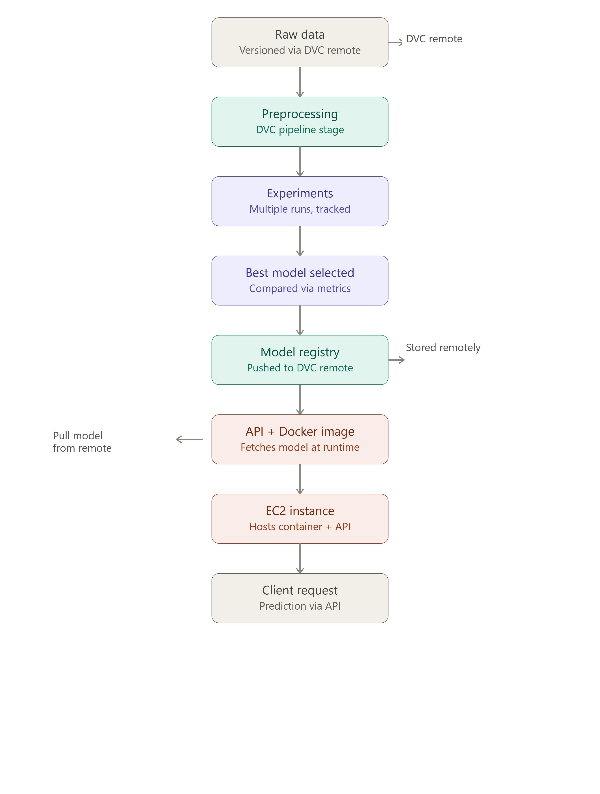
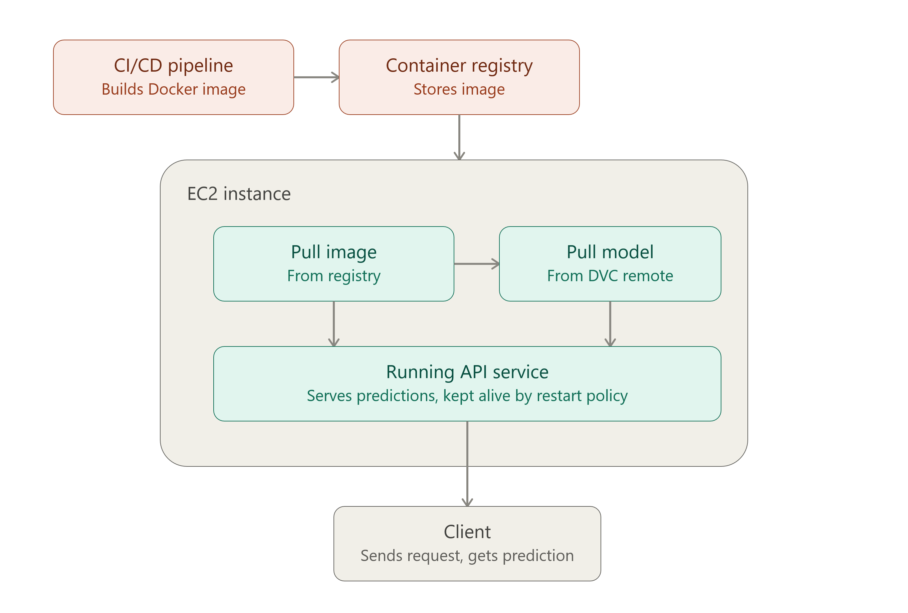

# CareerFlowOps: terminal presentation and automatic release

This guide follows the two supplied diagrams and uses real artifacts and commands. Run from the repository root. Commands that need GitHub/AWS access fail if the required account configuration is missing; the project does not invent successful cloud evidence.

## 1. Open the project and inspect its actual versions

```bash
cd /home/amitkumar/Music/CareerFlowOps
export DOCKER_HOST=unix:///var/run/docker.sock
export PATH="$PWD/.venv-tools/bin:$PATH"
make status
```

`make status` displays the current Git SHA, Python/library versions, all seven pipeline stages, training commit, dataset hash, selected model version, MLflow run/version and HTTP readiness. Git, dataset, model, MLflow and image identities are distinct; they do not share one version number.

## 2. Show the full data and model pipeline



```bash
.venv/bin/dvc dag --mermaid
.venv/bin/dvc status
make reproduce
```

The stages are **ingest → preprocess → build_training_set → train → evaluate → register → export_model**. DVC reruns changed stages and reuses unchanged artifacts. `register` is deliberately revisited to verify external MLflow state. To demonstrate a genuinely new full experiment run, use this explicitly instead of `make reproduce`:

```bash
.venv/bin/python infra/scripts/host.py .venv/bin/dvc repro --force
.venv/bin/dvc push -r storage
```

This creates real experiment runs and can promote a new model version. It does not overwrite candidate profiles. The training fixture uses frozen real ATS data; the live job database is separate. The small six-query benchmark has illustrative agent-authored judgments, not human-validated production accuracy. The semantic model is pretrained, not supervised-fine-tuned here.

## 3. Serve and verify the selected model locally

After building the local images, start the production model-serving mode:

```bash
docker compose build api web
make serve-release
curl --fail http://localhost:8000/ready
make present
```

`make serve-release` uses the production model overlay with locally built images. It does not create AWS resources. `/ready` must include a non-null bundle ID and model version.

`make present` shows image versions and the DVC graph/status, checks the actual MLflow alias/runs, creates a fresh isolated DVC workspace, pulls the selected bundle, validates its files/code compatibility and runs an explained prediction against real jobs. Its fictional profile exists only in memory. It refuses to claim success if the running API bundle differs from the pulled release. Actual evidence is saved to ignored `ops-private/evidence/presentation.json`.

This default presentation uses the local `storage` remote. After S3 setup:

```bash
make present DVC_REMOTE=production
```

That uses the S3-capable `.venv-deploy` environment and demonstrates a real remote pull. A local filesystem pull is labeled local and is not EC2/S3 evidence.

## 4. Show the user-facing application

Open http://localhost:5173 and http://localhost:8000/docs. Use Workspace access with locally stored candidate/admin tokens. Review a real resume/profile before using the protected candidate recommendation endpoint. The terminal presentation does not replace a user's saved profile with test data.

Demonstrate Discover → job provenance/official apply URL → For you/explanations → Saved jobs → manual application update/history. Show TPO aggregates, Model experiments, Source health and System & guide. Opening Apply does not submit an application.

Show the actual experiment runs at http://localhost:5000. Show Prometheus at http://localhost:9090 and Grafana at http://localhost:3000. No measured metric should be edited for screenshots.

## 5. Synchronize artifacts and code

Commit reviewed source changes first. The synchronization command never auto-stages arbitrary source files, credentials or private data:

```bash
git status --short
# Stage only files you reviewed, then commit your actual source changes.
make sync
```

`make sync` validates the current exported model, requires an up-to-date export pointer, pushes DVC objects first, commits only a changed `dvc.lock`, then pushes `main` to origin. A failed DVC upload stops before the Git commit/push. If Git authentication fails afterwards, retry after login; already-uploaded objects remain safe.

For the cloud remote, use:

```bash
make sync DVC_REMOTE=production
```

For the full tested release, from committed reviewed source:

```bash
make release DVC_REMOTE=production
```

That runs tests/lint/frontend build, DVC reproduction, selected-model validation, artifact upload and Git synchronization. The default `storage` remote remains available for the local demonstration. Use `production` to publish S3 objects; the two are not interchangeable evidence.

## 6. Show GitHub CI and immutable image versions

The `main` push automatically runs CI and builds both images. ECR publishing runs only when `AWS_ROLE_ARN` is configured. Both images use the full pushed Git SHA and carry an OCI revision label.

```bash
gh run list --repo Amitkumarracha/CareerFlowOps --workflow docker-publish.yml
git rev-parse HEAD
git log -5 --oneline
```

Inspect the run in GitHub Actions. A build with publishing skipped is not an ECR deployment. When configured, verify both repositories:

```bash
export RELEASE_SHA="$(git rev-parse HEAD)"
aws ecr describe-images --repository-name careerflowops-api --image-ids "imageTag=$RELEASE_SHA"
aws ecr describe-images --repository-name careerflowops-web --image-ids "imageTag=$RELEASE_SHA"
```

## 7. Show EC2 pulling image and model



The existing [AWS guide](remaining/03_AWS_DEPLOYMENT.md) provides account, S3/ECR, IAM/OIDC, instance creation, Docker, secrets, TLS and initial deployment commands. Prepare the host once before enabling automatic deployment. First-time setup is not performed by a Git push.

EC2 deployment runs `infra/aws/deploy.sh`: it checks image SHA against the checkout, pulls ECR images and the DVC production bundle, validates inference inside the published API image, applies migrations, starts the service with restart policies and compares the active bundle ID with the downloaded manifest.

Subsequent deployments can be automated through SSM using [AUTOMATIC_DEPLOYMENT.md](AUTOMATIC_DEPLOYMENT.md). No SSH private key is stored in GitHub. The job runs only after both ECR images were published successfully, automatic deployment was explicitly configured and the requested commit is still the tip of main.

## 8. Repeat after a project change

1. Change the relevant feature/data/parameter and test it.
2. Commit reviewed source so new training records a real code revision.
3. Run `make release DVC_REMOTE=production`.
4. Watch GitHub CI/build/ECR/optional EC2 jobs.
5. Verify `/ready`, candidate predictions and monitoring on the destination.

Git does not upload local files that have never been committed. There is intentionally no background “commit every file” watcher. DVC detects tracked dependency changes; the release command performs ordered synchronization; GitHub performs configured delivery after the push.

For backup, recovery, restart testing and assessment screenshots, follow [operations and assessment](remaining/04_OPERATIONS_AND_ASSESSMENT.md). Keep private credentials and candidate data out of the recording.
